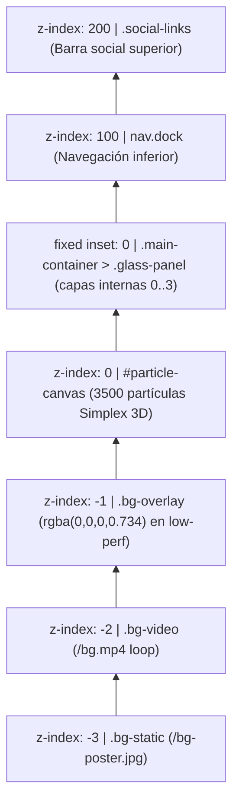

# Qunitrix — Design System & Especificación Visual (`DESIGN.md`)

> **Proyecto:** `qunitrix-landing` ([https://www.qunitrix.com](https://www.qunitrix.com))  
> **Stack Frontend:** Astro 5 (Static Output) · Vanilla CSS3 · SVG Filters · HTML5 Canvas 2D  
> **Concepto Estético:** *Bioluminescent Liquid OS* — Minimalismo espacial con cristal líquido refractivo y atmósfera cyber-orgánica.

---

## 1. Visión General y Filosofía de Diseño

La landing page de **Qunitrix** abandona el paradigma tradicional de página web con scroll vertical largo para comportarse como un **entorno espacial de escritorio a pantalla completa (*Zero-Scroll Spatial Canvas*)**.

### Principios Rectores
1. **Inmersión Espacial Fija (`100vw × 100vh`)**: Toda la experiencia ocurre dentro de un viewport fijo sin desplazamiento (`user-select: none`), donde la interfaz flota sobre un ecosistema vivo en movimiento.
2. **Materialidad Óptica (*Liquid Glass*)**: Los contenedores no son simples cajas con `backdrop-filter: blur()`; utilizan una arquitectura óptica de **4 capas** combinada con un filtro SVG de turbulencia fractal y desplazamiento (`#glass-distortion`) que refracta la luz del fondo como vidrio curvo real.
3. **Contraste Bioluminiscente**: Una paleta estrictamente controlada contrapone profundidades abisales verde-petróleo (`#061d22` / `#030809`) contra un único color de acento eléctrico de alta energía (**Cyber Lime `#ccff11`**) y tipografía blanca pura (`#ffffff`).
4. **Física Táctil y Directa**: El panel principal puede arrastrarse libremente por el espacio (con límites elásticos del 70% del viewport), el fondo de partículas responde a los tres botones del mouse con fuerzas gravitatorias/repulsivas, y las tarjetas reaccionan con curvas elásticas tipo *spring*.
5. **Rendimiento Consciente (*Graceful Degradation*)**: La riqueza visual (video + refracción SVG + 3.500 partículas Simplex 3D) está respaldada por un motor de telemetría de hardware y FPS en tiempo real que degrada la escena hacia un modo ligero (`body.low-perf`) sin perder coherencia estética.

---

## 2. Identidad de Marca y Geometría del Isotipo

El isotipo de **Qunitrix** es una **"Q" geométrica octogonal achaflanada**, construida sobre una retícula matemática exacta de **`1024 × 1024`** unidades (`public/qunitrix-logo.svg` y `#logo-clickable` en `src/pages/index.astro`).

### Proporciones Modulares de la Retícula
| Parámetro Geométrico | Valor (unidades SVG) | Proporción sobre `1024` | Rol Estructural |
| :--- | :--- | :--- | :--- |
| **Lienzo (`viewBox`)** | `0 0 1024 1024` | `100% × 100%` | Cuadrado perfecto `1:1` |
| **Módulo / Grosor de Anillo** | `226.96` | `22.164%` | Ancho de paredes perimetrales y cateto de chaflanes |
| **Tramo Recto Central** | `570.08` | `55.672%` | Longitud de caras ortogonales (`1024 - 2 × 226.96`) |
| **Ejes de Corte** | `0` · `226.96` · `797.04` · `1024` | `0%` · `22.16%` · `77.84%` · `100%` | Coordenadas maestras de ensamblaje |
| **Ápice de Cuña Interna (`Q`)** | `(226.96, 587.32)` | `Y = 57.355%` | Elevación diagonal interna de `209.72` u (~`20.2°`) |

### Anatomía de las 9 Piezas (`piece-a` a `piece-i`)
- **4 Chaflanes Esquineros (`<polygon>`)**: Triángulos rectángulos isósceles de `226.96 × 226.96` en las cuatro esquinas (`piece-a` sup-izq, `piece-b` inf-izq, `piece-c` sup-der, `piece-d` inf-der) que otorgan la silueta octogonal técnica.
- **4 Barras Perimetrales (`<rect>`)**: Bloques de `226.96 × 570.08` que cierran el marco exterior (`piece-g` izquierda, `piece-f` inferior, `piece-i` derecha, `piece-h` superior).
- **1 Cuña Diagonal Identitaria (`piece-e`, `<polyline>`)**: Triángulo rectángulo interior (`797.04 797.04 → 226.96 587.32 → 226.96 797.04`) que rompe la simetría del vano central e introduce el trazo ascendente característico de la **Q**.
- **Sellado Anti-Subpíxel**: Todas las piezas aplican `fill: #ccff11; stroke: #ccff11; stroke-width: 5px;` para evitar costuras transparentes (*hairline gaps*) entre polígonos adyacentes durante transformaciones CSS.

### Reglas de Uso y Variantes del Ecosistema
- **Tamaño fluido en Hero**: `max-width: clamp(200px, 25vw, 350px)` con `opacity: 0.95` y `margin: 1rem`.
- **Activo Open Graph (`public/logoQunitrix.png`)**: Isotipo `#ccff11` centrado sobre lienzo sólido `#030809`.
- **Variantes de Subproductos (`Logos/Logo_V1.png` – `Logo_V5.png`)**: Derivaciones modulares basadas en la misma geometría octogonal achaflanada en verde esmeralda (`~#28A962`) con conectores/pines laterales para aplicaciones verticales del ecosistema (ej. **StockApp**).

---

## 3. Sistema de Color y Paleta Atmosférica

La paleta evita los grises neutros opacos; toda jerarquía secundaria se construye mediante **transparencias blancas o negras con desenfoque de fondo** sobre el verde petróleo base.

### Tokens CSS Globales (`:root`)
```css
:root {
    --green: #ccff11;                        /* Acento primario Cyber Lime */
    --green-dim: rgba(204, 255, 17, 0.15);   /* Resplandor ambiental suave */
    --green-glow: rgba(204, 255, 17, 0.3);   /* Halo exterior luminiscente */
    --glass-bg: rgba(6, 29, 34, 0.7);        /* Tinte base del cristal líquido */
    --glass-border: rgba(204, 255, 17, 0.12);/* Borde translúcido con tinte lima */
    --shine: rgba(204, 255, 17, 0.1);        /* Reflejo especular interior del cristal */
}
```

### Mapa Completo de Colores y Superficies
| Rol / Elemento | Valor Exacto | Muestra Conceptual | Uso en la Interfaz |
| :--- | :--- | :--- | :--- |
| **Brand Accent (`--green`)** | `#ccff11` (`hsl(71.4, 100%, 53.3%)`) | Lima Ácido Eléctrico | Isotipo SVG, subtítulo `SOFTWARE`, hover de `.social-link` y título activo de `.project-card` |
| **Canvas Base (`body`)** | `#061d22` | Petróleo Abisal | Fondo global del documento, sombra de texto en `.section-title` y texto invertido en hover social |
| **Browser Chrome / OG Bg** | `#030809` | Negro Cian Profundo | `meta[name="theme-color"]` y fondo de `logoQunitrix.png` |
| **Texto Primario** | `#ffffff` | Blanco Puro | Títulos, botones del dock, etiquetas de tarjetas y enlaces sociales |
| **Tinte Cristal (`--glass-bg`)** | `linear-gradient(135deg, rgba(6,29,34,0.7), rgba(255,255,255,0.05))` | Vidrio Ahumado | Capa `.glass-tint` en `.glass-panel` y `.dock-glass` |
| **Píldora Dock (Inactiva)** | `rgba(255, 255, 255, 0.25)` + borde `rgba(255, 255, 255, 0.18)` | Cristal Escarchado Claro | `.dock-item` en reposo (`opacity: 0.7`) |
| **Píldora Dock (Activa)** | `rgba(0, 0, 0, 0.45)` + borde `rgba(255, 255, 255, 0.25)` | Obsidiana Translúcida | `.dock-item.active` (`opacity: 1`) |
| **Tarjeta Servicio (Reposo)** | `rgba(0, 0, 0, 0.25)` + borde `rgba(255, 255, 255, 0.18)` | Cápsula Oscura Suave | `.project-card` estado inicial |
| **Tarjeta Servicio (Hover)** | `rgba(0, 0, 0, 0.45)` + borde `rgba(204, 255, 17, 0.45)` | Cápsula Energizada | `.project-card:hover` con halo `0 0 30px rgba(204, 255, 17, 0.15)` |
| **Overlay `low-perf`** | `rgba(0, 0, 0, 0.734)` | Velo Oscuro de Contraste | `.bg-overlay` activo cuando se desactivan partículas |
| **Trazos de Partículas** | `hsla(70..80, 75%, 50%, 0.55)` (`lighter`) | Bioluminiscencia Dinámica | Enjambre Canvas 2D con oscilación cíclica de matiz (`+0.5°/frame`) |

---

## 4. Tipografía y Jerarquía Textual

El sistema utiliza una **única familia tipográfica** para mantener cohesión geométrica y velocidad de carga:

- **Fuente:** [`Space Grotesk`](https://fonts.google.com/specimen/Space+Grotesk) (`sans-serif`), importada desde Google Fonts con `display=swap`.
- **Pesos Cargados:** `300` (Light), `400` (Regular), `600` (SemiBold), `700` (Bold).
- **Carácter Visual:** Neo-grotesca geométrica de inspiración técnica cuyas formas cuadradas dialogan directamente con los chaflanes de 45° del isotipo.

### Escala Tipográfica y Especificaciones
| Elemento | Selector | Tamaño (Desktop / Móvil) | Peso | Tracking (`letter-spacing`) | Case | Efectos / Notas |
| :--- | :--- | :--- | :--- | :--- | :--- | :--- |
| **Título de Vista** | `.view .section-title` (`h2`) | `2rem` (`32px`) / `2rem` | `600` | `0.1em` | Natural | `text-shadow: 0 0 20px #061d22`; `margin-bottom: 2rem` |
| **Subtítulo Hero** | `.view .subtitle` (`p`) | `clamp(0.9rem, 2vw, 1.2rem)` | `300` | `0.3em` | `UPPERCASE` | Color `#ccff11`; doble glow `20px` (`0.5`) + `40px` (`0.3`) |
| **Ítem de Dock** | `.dock-item` (`button`) | `0.95rem` / `0.85rem` | `400` | `0.08em` | `UPPERCASE` | `opacity: 0.7` → `0.9` (hover) → `1.0` (activo) |
| **Nombre Servicio** | `.project-card h3` | `0.95rem` / `0.8rem` | `400` | `0.05em` | Natural | `opacity: 0.8` blanco → `1.0` `var(--green)` en hover |
| **Enlace Social** | `.social-link` (`a`) | `0.85rem` / `0.75rem` | `400` | `0.08em` | `UPPERCASE` | Inversión total de color en hover (`bg: #ccff11`, `text: #061d22`) |

---

## 5. Sistema "Liquid Glass" (Arquitectura Óptica Multicapa)

El sello visual principal de Qunitrix es su material **Liquid Glass**, aplicado tanto en `.glass-panel` como en `.dock-glass`. A diferencia del *glassmorphism* convencional plano, simula **refracción óptica no uniforme**.

### 5.1 Filtro SVG de Refracción (`#glass-distortion`)
Definido de forma oculta al inicio del `<body>` (`.svg-filters`):
1. **Ruido Base (`feTurbulence`)**: `type="fractalNoise"`, `baseFrequency="0.01 0.01"`, `numOctaves="1"`, `seed="5"`. Genera ondas amplias y orgánicas sin grano fino.
2. **Mapeo y Suavizado (`feComponentTransfer` + `feGaussianBlur`)**: Curva gamma en canal R (`exponent="10"`, `offset="0.5"`) y desenfoque gaussiano `stdDeviation="3"` (`result="softMap"`).
3. **Desplazamiento Óptico (`feDisplacementMap`)**: Deforma `SourceGraphic` usando `softMap` con **`scale="150"`** en los canales `R` (eje X) y `G` (eje Y), curvando la luz del video y las partículas en los bordes del cristal.

### 5.2 Pila de 4 Capas de un Contenedor Liquid Glass
Todo componente de cristal líquido debe respetar esta estructura DOM y orden de apilamiento (`border-radius: 2rem`):

```html
<div class="glass-panel"> <!-- Contenedor raíz: overflow: hidden; border-radius: 2rem -->
    <div class="glass-effect"></div>  <!-- z-index: 0 | backdrop-filter: blur(3px) + filter: url(#glass-distortion) -->
    <div class="glass-tint"></div>    <!-- z-index: 1 | linear-gradient(135deg, var(--glass-bg), rgba(255,255,255,0.05)) -->
    <div class="glass-shine"></div>   <!-- z-index: 2 | Bisel especular inset con var(--shine) -->
    <div class="glass-content">       <!-- z-index: 3 | Contenido nítido sin distorsión -->
        ...
    </div>
</div>
```

- **Elevación Exterior Común**: `box-shadow: 0 6px 6px rgba(0, 0, 0, 0.2), 0 0 20px rgba(0, 0, 0, 0.1)`.
- **Bisel Especular (`.glass-shine`)**: `box-shadow: inset 2px 2px 1px 0 var(--shine), inset -1px -1px 1px 1px var(--shine)` — crea un filete de luz lima de `1–2px` que perfila el volumen del cristal sin requerir un `border` sólido pesado.

---

## 6. Arquitectura Espacial, Capas (`z-index`) y Fondo Vivo

La escena completa se compone de **7 estratos superpuestos** en coordenadas `position: fixed`:



### Motor Atmosférico de Partículas (`#particle-canvas`)
- **Algoritmo**: Campo vectorial impulsado por ruido **Simplex 3D (`Perlin.prototype.simplex3d`)** evaluado en `(x / 200, y / 200, ±Date.now() / 5000)` con amortiguación de velocidad (`v.mul(0.94)`) y *screen wrapping* toroidal (`wrap2d`).
- **Densidad Adaptativa**: `3.500` partículas en escritorio; `1.200` partículas en pantallas `<= 600px` o dispositivos táctiles (`maxTouchPoints > 1`).
- **Estela Lumínica**: En cada frame aplica `source-over` negro al `10%`, `destination-out` al `3.5%` (desvanecimiento gradual sin residuos permanentes) y dibuja vectores con `globalCompositeOperation = "lighter"`.
- **Física Interactiva Oculta (*Easter Eggs de Mouse*)**:
  - **Click Izquierdo sostenido**: Atracción gravitatoria global hacia el puntero (`factor 0.00085`).
  - **Click Derecho sostenido**: Campo de repulsión explosiva en un radio de `200–250px` (`factor 0.02`).
  - **Click Central sostenido**: Pozo de amortiguación viscosa en un radio de `200–250px` (`v.mul(d / l)`).

---

## 7. Catálogo de Componentes UI y Patrones de Interacción

### 7.1 Panel Central Adaptativo y Arrastrable (`.glass-panel`)
- **Geometría Dinámica por Vista**:
  - **Vista `inicio`**: `width: min(420px, calc(100vw - 2rem))`, `min-width: 320px`, `min-height: 300px`. Encuadre compacto cuasi-cuadrado alrededor del isotipo.
  - **Vista `servicios` (`.mode-servicios`)**: Se expande simétricamente desde el centro hasta `width: min(560px, calc(100vw - 2rem))`.
- **Padding de Vista (`.view`)**: `2rem 2.5rem` en desktop (`1.5rem 0.8rem` en móvil).
- **Sistema Drag & Drop con Jaula Elástica (Desktop `> 600px`)**:
  - Permite arrastrar el panel desde cualquier superficie libre (ignora clicks sobre `.dock-item, button, a, .project-card`).
  - Añade `.is-dragging` (`transition: none !important`) durante el movimiento para respuesta `1:1` sin *lag*.
  - **Límites del 70% del Viewport**: El centro y bordes del panel se restringen matemáticamente dentro de la franja `15% – 85%` tanto en X como en Y. Al cambiar de `inicio` (`420px`) a `servicios` (`560px`), el offset se recalcula y re-clampea automáticamente para impedir que el nuevo ancho desborde la zona segura.

### 7.2 Dock Flotante de Navegación (`nav.dock`)
- **Posición**: Fijo centrado inferior (`bottom: 2rem`, `left: 50%`, `transform: translateX(-50%)`).
- **Contenedor Interno (`.dock-items`)**: `display: flex; gap: 0.5rem; padding: 0.5rem; border-radius: 2rem`.
- **Botones (`.dock-item`)**: Cápsulas con `border-radius: 1.5rem`, `padding: 0.7rem 1.8rem`, `backdrop-filter: blur(12px)`. El estado `.active` oscurece el fondo a `rgba(0, 0, 0, 0.45)`, sube el desenfoque a `blur(16px)` y añade sombra interior `inset -2px -2px 2px rgba(0, 0, 0, 0.15)`.
- **Sincronización por URL Hash**: Soporta `#inicio`, `#servicios` y el alias legado `#proyectos` (redirigido transparentemente a `servicios`), reaccionando tanto en la carga inicial como al evento `hashchange`.

### 7.3 Grid y Tarjetas de Servicios (`.projects-grid` & `.project-card`)
- **Distribución**: Flexbox centrado con estiramiento uniforme (`justify-content: center; align-items: stretch; gap: 1.25rem; flex-wrap: wrap`).
- **Dimensiones de Tarjeta**: `flex: 1 1 120px; max-width: 140px; padding: 1.5rem 1.25rem; border-radius: 1.5rem; gap: 0.8rem`.
- **Iconografía (`.project-icon`)**: `68px × 68px` (`object-fit: contain`).
- **Respuesta Hover**:
  - Elevación física: `transform: translateY(-4px) scale(1.04)`.
  - Encendido cromático: Borde `rgba(204, 255, 17, 0.45)`, halo exterior `0 0 30px rgba(204, 255, 17, 0.15)`, escala de ícono a `1.08` y texto `h3` en `--green`.

### 7.4 Barra de Enlaces Sociales (`.social-links`)
- **Posición Desktop**: Esquina superior izquierda (`top: 2rem; left: 2rem; gap: 0.75rem`).
- **Estilo Brutalista-Limpio**: Sin fondo ni borde en reposo (`padding: 0.5rem 1rem; border-radius: 0.25rem`). En `:hover`, aplica relleno sólido `var(--green)` (`#ccff11`) con texto `#061d22`, generando el acento de mayor contraste puntual de toda la interfaz.

---

## 8. Coreografía de Movimiento y Animaciones (*Motion System*)

El sistema evita curvas lineales genéricas y emplea **3 familias de curvas Bézier** con roles semánticos diferenciados:

| Curva / Función de Tiempo | Valor CSS | Sensación Física | Dónde se aplica |
| :--- | :--- | :--- | :--- |
| **Expo-Out Arquitectónica** | `cubic-bezier(0.16, 1, 0.3, 1)` | Rápida salida, frenado sedoso sin rebote | Expansión de ancho/alto de `.glass-panel` (`0.45s`), entrada de `.section-title` y `.project-card` |
| **Spring / Overshoot Controlado** | `cubic-bezier(0.34, 1.56, 0.64, 1)` | Rebote mecánico preciso de ensamblaje | Ensamblaje de las 9 piezas del logo (`0.5s`) y pop secundario de `.project-icon` (`0.5s`) |
| **Elástica Viva (Dock Feel)** | `cubic-bezier(0.175, 0.885, 0.32, 2.2)` | Rebote expresivo y juguetón al tacto | Hover de `.project-card` (`0.4s`), `.project-icon` (`0.3s`) y transiciones de `.dock-glass` (`0.4s`) |

### Secuencias Coreografiadas Clave
1. **Ensamblaje del Isotipo (`logoAssemble`, `0ms → 1200ms`, consolidado a `1500ms`)**:
   - **Fase 1 — Esquinas (`0ms – 240ms`, paso `80ms`)**: `piece-a` (`0ms`, origen `0 0`), `piece-b` (`80ms`, origen `0 1024`), `piece-c` (`160ms`, origen `1024 0`), `piece-d` (`240ms`, origen `1024 1024`).
   - **Fase 2 — Paredes Perimetrales (`350ms – 560ms`, paso `70ms`)**: `piece-g` (`350ms`), `piece-f` (`420ms`), `piece-i` (`490ms`), `piece-h` (`560ms`) cierran el octágono en sentido antihorario.
   - **Fase 3 — Firma de Marca (`700ms`)**: `piece-e` emerge desde `(512px, 700px)` completando la cuña interior de la **Q**. A los `1500ms`, JavaScript fija `opacity: 1; transform: scale(1); animation: none`.
2. **Cascada con Acción Secundaria en Vista Servicios (`#view-servicios.active`)**:
   - `80ms`: `.section-title` desciende `8px` (`serviceTitleIn`, `0.4s`).
   - `180ms` / `270ms` / `360ms` (cadencia de **`90ms`**): Las 3 `.project-card` ascienden `18px` escalando desde `0.9` (`serviceCardIn`, `0.45s`).
   - `220ms` / `310ms` / `400ms` (**`+40ms` de desfase respecto a su tarjeta**): Cada `.project-icon` ejecuta su propio pop desde `scale(0.7)` (`serviceIconIn`, `0.5s`), logrando superposición orgánica de movimiento (*overlapping action*).

---

## 9. Estrategia Responsiva y Adaptabilidad

El sistema mantiene un diseño fluido basado en `min()`, `clamp()` y unidades relativas, con un **único punto de quiebre estructural en `600px`** (`@media (max-width: 600px)`):

| Aspecto | Escritorio (`> 600px`) | Móvil (`<= 600px`) |
| :--- | :--- | :--- |
| **Posicionamiento del Panel** | `position: absolute`, centrado `50%/50%`, arrastrable | `position: relative` en Flexbox centrado (`padding: 1rem`), **no arrastrable** |
| **Ancho del Panel** | `420px` (Inicio) ↔ `560px` (Servicios) | `100%` fluido con tope `max-width: 440px` en ambas vistas |
| **Enlaces Sociales** | Esquina sup-izq (`top: 2rem; left: 2rem`) | Barra superior centrada (`top: 1rem; width: 100%; gap: 0.25rem`, `0.75rem`) |
| **Dock Inferior** | `bottom: 2rem`; botones `0.7rem 1.8rem` (`0.95rem`) | `bottom: 1rem`; botones `0.6rem 1.2rem` (`0.85rem`) |
| **Tarjetas de Servicios** | `max-width: 140px`, `gap: 1.25rem`, ícono `68px` | `flex: 1 1 80px`, `max-width: 105px`, `gap: 0.5rem`, ícono `48px` (mantiene las 3 en fila) |
| **Presupuesto de Partículas** | `3.500` partículas activas | `1.200` partículas activas |

---

## 10. Rendimiento Adaptativo (`low-perf`) y Accesibilidad

El script `checkLowPerformanceMode()` evalúa **7 señales progresivas** antes y durante la ejecución para proteger la fluidez y batería del usuario:

1. **Override de QA por URL**: `?perf=low` fuerza el modo ligero; `?perf=high` fuerza efectos completos.
2. **Accesibilidad del SO**: `prefers-reduced-motion: reduce` (además oculta `.bg-video` por CSS puro).
3. **Ahorro de Datos**: `navigator.connection.saveData === true`.
4. **CPU Limitada**: `navigator.hardwareConcurrency <= 2` núcleos lógicos.
5. **Memoria Limitada**: `navigator.deviceMemory <= 2` GB de RAM.
6. **Inspección de GPU / WebGL**: Desactiva partículas si WebGL no existe o si `WEBGL_debug_renderer_info` detecta renderizado por software (`swiftshader`, `llvmpipe`, `microsoft basic render`, `mesa`, `gdi generic`, `cpu`).
7. **Watchdog de FPS en Tiempo Real**: Durante una ventana de calentamiento de `60` frames (ignorando los primeros `5`), si más de `12` frames superan `35ms` (`< ~28.5 FPS`), detiene el loop `requestAnimationFrame`, limpia el canvas y activa `body.low-perf`.

### Adaptaciones Visuales de `body.low-perf`
- Desactiva y oculta `#particle-canvas`.
- Hace visible `.bg-overlay` (`rgba(0, 0, 0, 0.734)`) con transición de `0.4s ease` para preservar exactamente la misma relación de contraste luminoso detrás del panel Liquid Glass que aportaba el canvas oscuro.
- Reduce las animaciones de entrada de tarjetas e íconos a `0.25s`.

---

## 11. Diagnóstico del Análisis y Guía para Futuras Extensiones

Al extender la web o diseñar interfaces hermanas (`StockApp`, `Kanban`, `Video`), se recomienda mantener las reglas anteriores y considerar estas oportunidades detectadas en el código actual:

1. **Unificación de Tokens CSS**: Las variables `--green-dim`, `--green-glow` y `--glass-border` ya están definidas en `:root`, pero algunas reglas emplean literales `rgba(204, 255, 17, 0.15)` / `0.3` / `0.45` directamente. Consumir siempre los custom properties facilitará ajustes globales de brillo.
2. **Sistema Iconográfico Propio por Producto**: Actualmente `StockApp` utiliza su isotipo dedicado (`/faviconStockApp.ico`), mientras que `Kanban` y `Video` reutilizan temporalmente `/favicon.ico`. Diseñar los isotipos de `Kanban` y `Video` sobre la misma retícula octogonal achaflanada de `1024 × 1024` (siguiendo la línea explorada en `/Logos/Logo_V1..V5.png`) consolidará una familia de marca coherente.
3. **Accesibilidad por Teclado y Semántica ARIA**:
   - Incorporar estados `:focus-visible` con contorno `1px solid var(--green)` y `box-shadow: 0 0 0 3px var(--green-dim)` en `.dock-item`, `.project-card` y `.social-link`.
   - Añadir `role="tablist"` / `role="tab"` / `aria-selected` en los botones del Dock y reemplazar el atributo no estándar `alt="Qunitrix"` del `<svg id="logo-clickable">` por `role="img"` + `aria-label="Qunitrix"`.
4. **Regla para Nuevas Vistas en el Panel**: Si se agrega una tercera vista al Dock (ej. *Contacto* o *Nosotros*), mantener la arquitectura de vista interna con ancho dedicado (`.glass-panel.mode-<vista>`) y conservar la página dentro del paradigma **Zero-Scroll Spatial Canvas** evitando superar `~75vh` de altura interna del panel.
